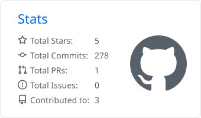
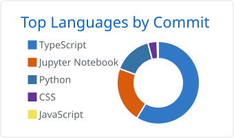

# Hi, I'm Ronn 👋

**CS & Business Systems graduate (RSET, 2026)** working where tech and business meet: AI/ML, data and product.

- 🚀 Former **Operations Head at Wizex**, where we took Wizechat, a WhatsApp automation SaaS for small businesses, from architecture to live customers in 4 months (16 active clients, ₹11.7 lakh ARR)
- 🎧 Former **Research Intern at IIT Mandi**, working on keeping sound-recognition models accurate across different recording devices
- 🏅 **MeitY IndiaAI Fellow** (₹1 lakh research grant) · 2 papers on IEEE Xplore
- 🛠️ Currently building a purchase and reorder app for a two-branch retail store on Microsoft SQL Server

---

## 🎯 Featured Work

### 🎧 Domain Adaptation for Acoustic Scene Classification
Sound-recognition models lose accuracy when audio comes from a different phone or recorder than the one used in training. This research, started at IIT Mandi and continued as my final-year project, makes them hold up across devices (DCASE TAU 2020 Mobile, PyTorch).

| Repository | What it does | Result |
| --- | --- | --- |
| [UDA-mfdwc-wavelet_features](https://github.com/RonnMath03/UDA-mfdwc-wavelet_features) | Final-year project: compares a PaSST transformer and lightweight MFDWC wavelet features, each with GRL and Cycle Self-Training | PaSST + GRL raised average accuracy on unseen devices from 53.9% to 65.5% |
| [UDA-Gradient-Reversal-Layer](https://github.com/UDA-IIT-Mandi/UDA-Gradient-Reversal-Layer) | IIT Mandi: PaSST with domain-adversarial training (DANN + gradient reversal layer) | 64.1% target accuracy, up from 51.9% without adaptation |
| [UDA-Cycle-Self-Training](https://github.com/UDA-IIT-Mandi/UDA-Cycle-Self-Training) | IIT Mandi: PaSST with Cycle Self-Training | 56.2% target accuracy, up from 51.9% |

📄 *State-of-the-Art Domain Adaptation in Deep Learning for Acoustic Scene Classification*, ICTEST 2026 (IEEE Xplore)

### 🌱 [Sustania](https://github.com/RonnMath03/Sustania): Smart Agriculture System
IoT irrigation system with soil-moisture and temperature sensing, a React dashboard and a scikit-learn prediction model (93.4% accuracy).
📄 *Sustania: A Digital Farming Ecosystem for Smart Agriculture*, ACCTHPA 2025 (IEEE Xplore)

### 🥗 [FoodFit](https://github.com/RonnMath03/FoodFit): Responsible Consumption Platform
Built in 24 hours at Hacksus'25 (UN SDG 12). Personalised portion recommendations, waste forecasts and meal suggestions to encourage sustainable eating.
`React` `TypeScript` `Flask` `scikit-learn` `XGBoost`

---

## 🛠️ Tech I Work With

**Languages & data:** Python · SQL (MS SQL Server, MySQL, Oracle) · TypeScript / JavaScript · C / C++ · Pandas · NumPy

**ML & AI:** PyTorch · scikit-learn · LLM integrations · domain adaptation · audio ML

**Web & cloud:** React · Node.js · Flask · REST APIs · Cloudflare · DigitalOcean

**AI-augmented development:** Claude Code · Antigravity · Gemini

---

## 📊 GitHub Stats

  <picture>
    <source media="(prefers-color-scheme: dark)" srcset="./profile-summary-card-output/github_dark/3-stats.svg" />
    
  </picture>
  <picture>
    <source media="(prefers-color-scheme: dark)" srcset="./profile-summary-card-output/github_dark/2-most-commit-language.svg" />
    
  </picture>

---

## 📫 Connect

